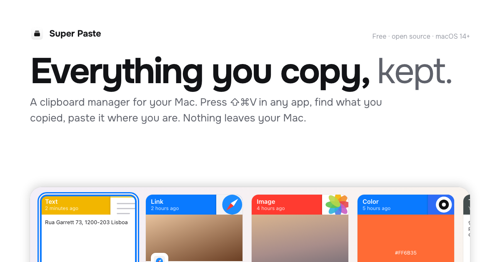
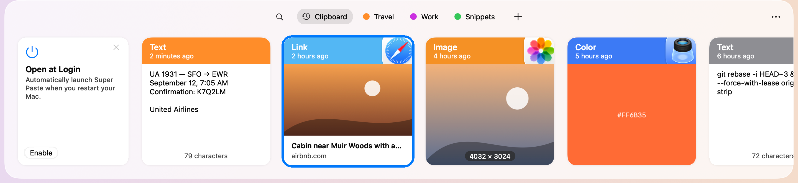
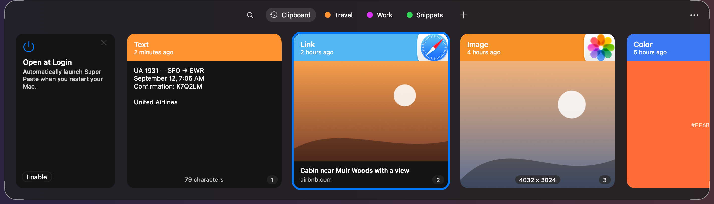
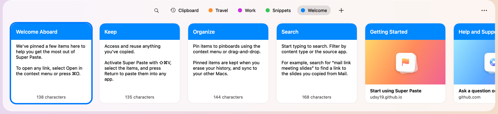
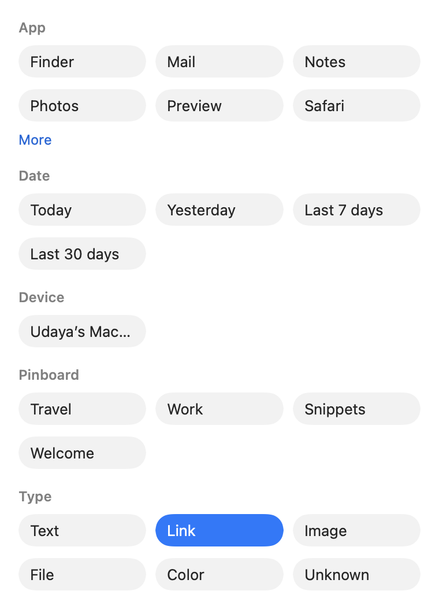
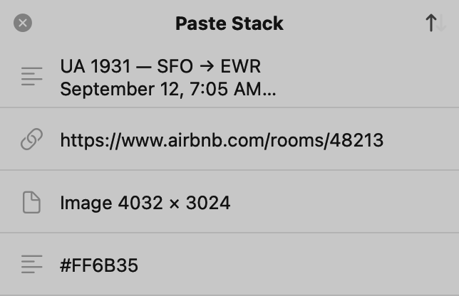
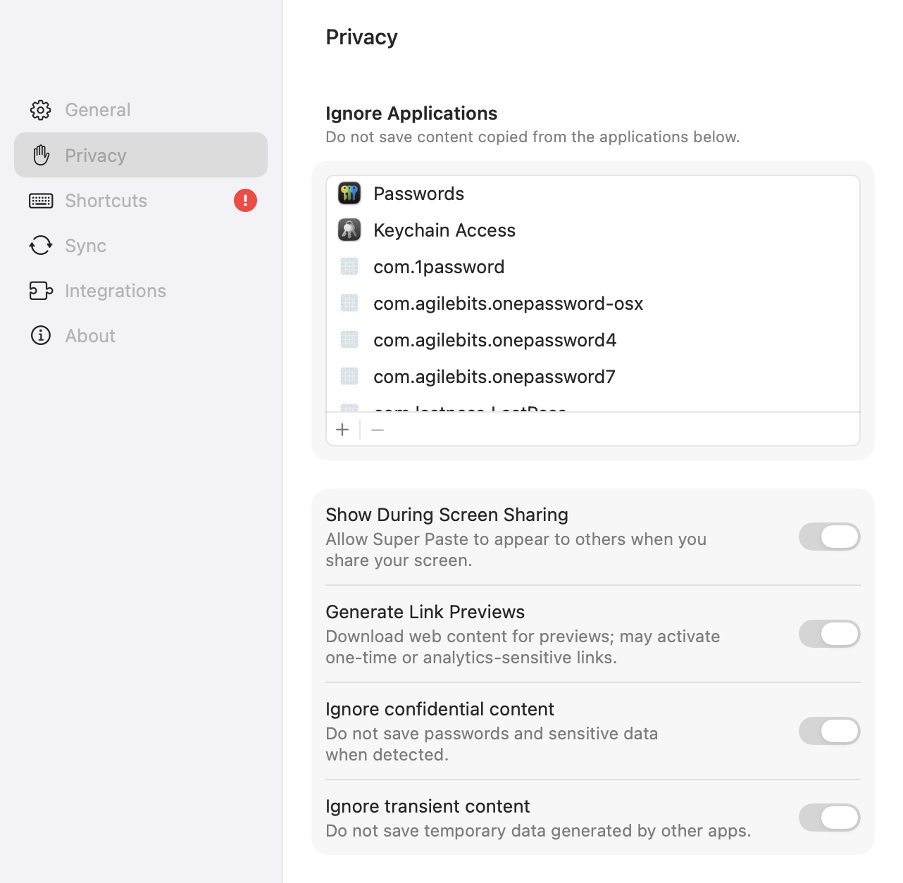
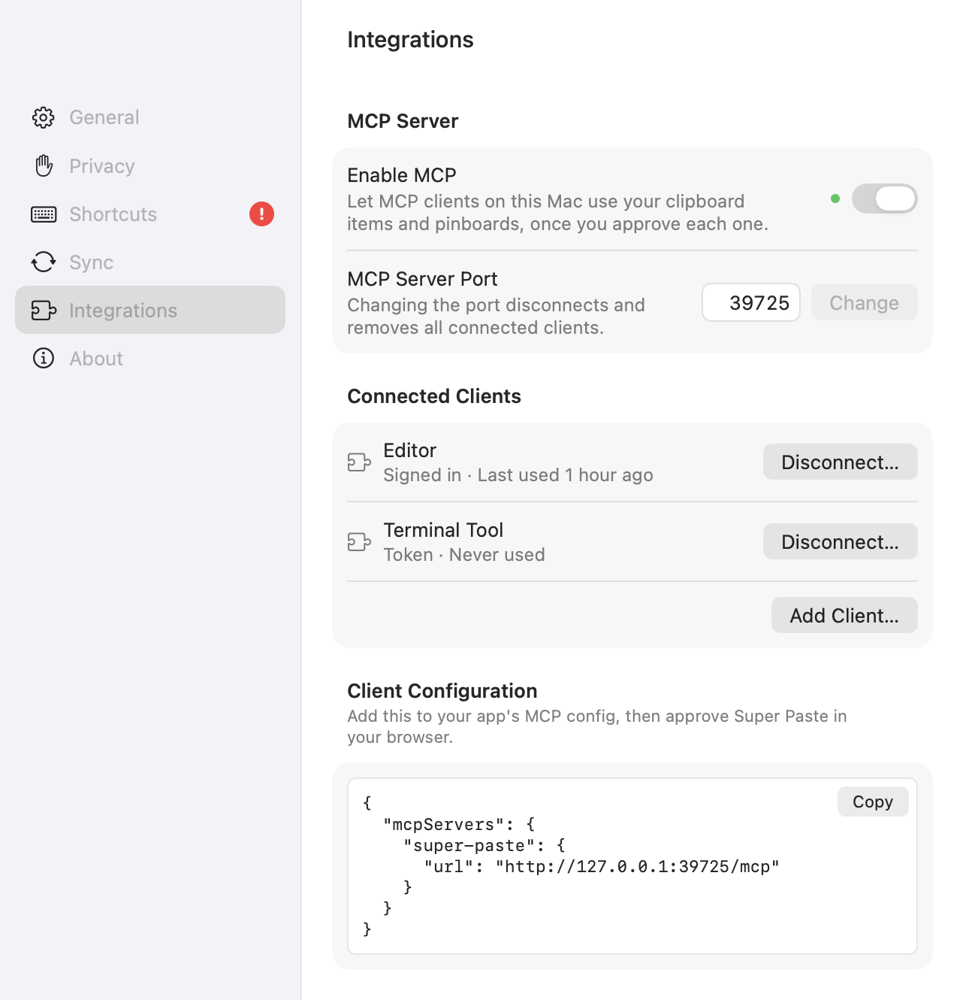
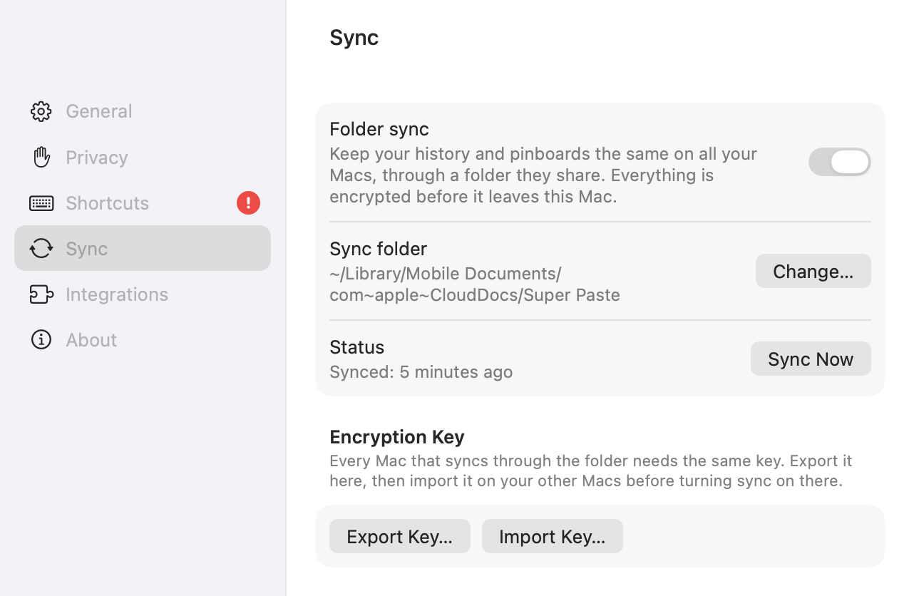
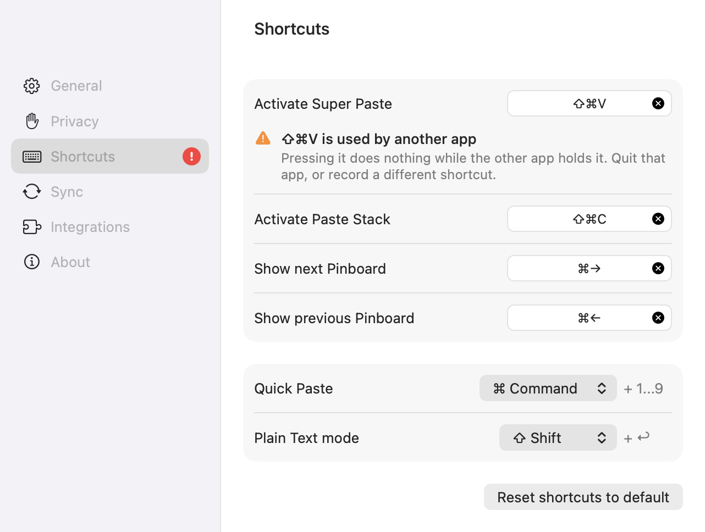

<p align="center">
  <a href="https://udsy19.github.io/super-paste/"></a>
</p>

<h1 align="center">Super Paste</h1>

<p align="center">
  <b>A free, open-source clipboard manager for macOS.</b><br>
  Everything you copy, searchable and one shortcut away.
</p>

<p align="center">
  <a href="https://github.com/udsy19/super-paste/releases/latest"></a>
  <a href="https://github.com/udsy19/super-paste/actions/workflows/ci.yml"></a>
  <a href="LICENSE"></a>
  
  
  
</p>

<p align="center">
  <a href="https://udsy19.github.io/super-paste/"><b>Website</b></a> ·
  <a href="https://github.com/udsy19/super-paste/releases/latest/download/SuperPaste.dmg"><b>Download DMG</b></a> ·
  <a href="docs/USAGE.md">User guide</a> ·
  <a href="docs/MCP.md">MCP reference</a> ·
  <a href="docs/ARCHITECTURE.md">Architecture</a> ·
  <a href="CHANGELOG.md">Changelog</a>
</p>

---

Super Paste remembers what you copy on your Mac (text, rich text, links, images, files, colours) and shows it as a
strip of cards along the bottom of the screen when you press <kbd>⇧⌘V</kbd>. Type to search, pick a card, press
Return, and it's pasted into the app you were in. Keep snippets in colour-coded pinboards, paste several things in a
row with the Paste Stack, and let AI tools on your Mac use your history through a local MCP server. It's a native
Swift and AppKit app with no account, no analytics and no servers: your history lives in a SQLite database in
`~/Library/Application Support` and leaves your Mac only if you turn on encrypted folder sync.

```bash
curl -fsSL https://udsy19.github.io/super-paste/install.sh | bash
```

## Contents

- [Screenshots](#screenshots)
- [Features](#features)
- [Install](#install)
- [Usage](#usage)
- [Privacy and security](#privacy-and-security)
- [Sync between Macs](#sync-between-macs)
- [MCP server for developers](#mcp-server-for-developers)
- [URL scheme](#url-scheme)
- [Architecture](#architecture)
- [Building from source](#building-from-source)
- [Contributing](#contributing)
- [FAQ](#faq)
- [Roadmap](#roadmap)
- [Credits](#credits)
- [License](#license)

## Screenshots

These are rendered from the app's own UI by the self-tests (`STRIPKIT_RENDER_DIR` / `SUPERPASTE_RENDER_DIR`), so
they're exact.

<p align="center">
  
  <br><sub>The strip (macOS 26 look). Each card shows the source app's colour and icon, the content, and a footer: character count, link domain, pixel size, file path, hex code.</sub>
</p>

<p align="center">
  
  <br><sub>Dark mode at the largest strip height, with ⌘ held: the first nine cards show their Quick Paste numbers.</sub>
</p>

<table>
  <tr>
    <td width="50%"><br><sub>Filters become tokens in the search field; tabs collapse to their icons while you search.</sub></td>
    <td width="50%"><br><sub>After onboarding, the strip opens on a Welcome pinboard with cards to try.</sub></td>
  </tr>
  <tr>
    <td><br><sub>⌘F opens the filter browser built from your own history.</sub></td>
    <td><br><sub>The Paste Stack: copy several things, then ⌘V pastes them one by one.</sub></td>
  </tr>
  <tr>
    <td><br><sub>Settings → Privacy: ignored apps, screen-sharing visibility, link previews, concealed and transient content.</sub></td>
    <td><br><sub>Settings → Integrations: the MCP server, connected clients and a copyable client configuration.</sub></td>
  </tr>
  <tr>
    <td><br><sub>Settings → Sync: a folder your Macs share and the key that seals everything written to it.</sub></td>
    <td><br><sub>Settings → Shortcuts: every global shortcut and both modifiers can be changed.</sub></td>
  </tr>
</table>

## Features

**History**

- Text, rich text, HTML, links, images, files and colours, each with the app and Mac it came from.
- Copying the same thing again moves it to the front instead of adding a duplicate.
- Kept forever by default; shorten it in Settings → General (a day to a year). Pinned items are never deleted.
- Link cards fetch the page's title, icon and preview image (switch off in Settings → Privacy).
- Preview with <kbd>Space</kbd>, edit text with <kbd>⌘E</kbd>, give an item a title with <kbd>⌘R</kbd>, open a link
  or file with <kbd>⌘O</kbd>, delete with <kbd>⌫</kbd> and undo with <kbd>⌘Z</kbd>.

**Finding things**

- Type as soon as the strip opens. Words match by prefix, ignoring case and accents.
- Filters: `app:Safari`, `type:link`, `date:yesterday`, `device:Studio`, `pinboard:Work`, `title:invoice`.
  Same-kind filters OR together, different kinds AND together. Full syntax in [docs/USAGE.md](docs/USAGE.md#search).
- <kbd>⌘F</kbd> opens a filter browser listing the apps, dates, devices, pinboards and types in your history.

**Pinboards**

- Named, colour-coded boards next to the history for the things you paste every week. Cards pinned to a board take its
  colour.
- Pin from a card's context menu or by dragging a card onto a tab; one item can be in several boards.
- <kbd>⌘←</kbd> / <kbd>⌘→</kbd> switch boards. <kbd>⌘N</kbd> writes a new text item straight into one.

**Pasting**

- Paste directly into the app you came from (the strip never takes focus). <kbd>Return</kbd>, a double-click, or
  <kbd>⌘1</kbd>…<kbd>⌘9</kbd> for the first nine cards.
- Plain text with <kbd>⇧</kbd> (<kbd>⇧Return</kbd>, <kbd>⇧⌘1</kbd>…) or always, from Settings.
- Select several cards (<kbd>⇧</kbd>-click, <kbd>⌘</kbd>-click, <kbd>⌘A</kbd>) and paste them one after another.
- **Paste Stack** (<kbd>⇧⌘C</kbd>): copy a few things, then each <kbd>⌘V</kbd> pastes the next one in order. Top or
  bottom first.
- **Hot-corner peek**: rest the pointer in a screen corner (bottom-left by default) and a peek of your three
  latest items slides out; click it to open the strip. It never takes focus, keeps out of full-screen apps and
  respects Reduce Motion. Off, or another corner, in Settings → General; a corner macOS already uses for its own
  Hot Corners is left alone.

**Privacy**

- Nothing from password managers is ever saved, nor anything an app marks concealed or transient. Add your own apps to
  the ignore list. Pause capturing for 15 minutes to 8 hours or until you resume.
- Hide the strip from screen sharing and recordings.
- No account, no analytics, no servers. See [Privacy and security](#privacy-and-security).

**Beyond one Mac**

- **Folder sync**: keep several Macs in step through any folder they share (iCloud Drive, Dropbox, a NAS). Everything
  is encrypted with AES-256-GCM on your Mac before it's written there.
- **MCP server**: let editors and assistants on your Mac search, read and add items and manage pinboards, after you
  approve each client. Loopback only.
- **URL scheme**: `superpaste://` opens the strip, a search or a Settings pane from Shortcuts, Raycast, Alfred or
  Terminal.

**The app**

- Swift and AppKit, no Electron, no third-party packages. A 4 MB universal download for macOS 14 Sonoma and later.
- Lives in the menu bar; the icon animates on every capture. No Dock icon, no main window.
- Updates itself in the background, verifying each release's SHA-256 and code signature first (switch off in
  Settings → About).
- Liquid Glass on macOS 26; the same layout as a flat panel on macOS 14 and 15.

## Install

**One line** (recommended). Downloads the latest release, verifies the disk image, installs into Applications and
opens it. Run it again to update. Because the app isn't downloaded by a browser, there's no Gatekeeper prompt.

```bash
curl -fsSL https://udsy19.github.io/super-paste/install.sh | bash
```

**DMG.** Download [SuperPaste.dmg](https://github.com/udsy19/super-paste/releases/latest/download/SuperPaste.dmg),
drag Super Paste to Applications and open it. Super Paste isn't notarized by Apple, so the first launch of a
browser-downloaded copy needs one extra step, once:

1. Open Super Paste. macOS says it can't verify the developer; click **Done**.
2. Open **System Settings → Privacy & Security** and scroll down to Security.
3. Click **Open Anyway** next to the Super Paste message, then **Open**.

**Permissions.** To paste straight into other apps, Super Paste sends <kbd>⌘V</kbd> to the app in front, which macOS
gates behind **Accessibility**. Super Paste asks the first time you paste; allow it under System Settings → Privacy
& Security → Accessibility. Decline and cards are copied to the clipboard for you to paste yourself. No other
permission is needed.

**Requirements.** macOS 14 Sonoma or later, Apple silicon or Intel.

**Uninstall.** Quit from the menu bar icon and delete Super Paste from Applications, or run
`curl -fsSL https://udsy19.github.io/super-paste/install.sh | bash -s -- --uninstall`. Your history stays in
`~/Library/Application Support/Super Paste` and settings in `~/Library/Preferences/com.udsy.superpaste.plist`;
delete those too to remove everything.

## Usage

The complete guide is [docs/USAGE.md](docs/USAGE.md). The short version:

1. Super Paste lives in the menu bar. Left-click the icon to open or close the strip; right-click for the menu.
2. Copy things as usual. Press <kbd>⇧⌘V</kbd> in any app to open the strip along the bottom of the screen.
3. Type to search, use <kbd>←</kbd> <kbd>→</kbd> to pick a card, press <kbd>Return</kbd> to paste it where you were.

### Keyboard shortcuts

Two are global; the rest work while the strip is open. The global shortcuts, the pinboard keys and both modifiers can
be changed in Settings → Shortcuts. If another app already holds one, Super Paste tells you once, flags it in
Settings, and takes the shortcut as soon as it's free.

| Shortcut | Action |
|---|---|
| <kbd>⇧⌘V</kbd> | Open or close the strip (global) |
| <kbd>⇧⌘C</kbd> | Start or close the Paste Stack (global); while it's open, <kbd>⌘V</kbd> pastes the next item |
| <kbd>Return</kbd> · <kbd>⇧Return</kbd> | Paste the selection · as plain text |
| <kbd>⌘1</kbd>…<kbd>⌘9</kbd> · <kbd>⇧⌘1</kbd>…<kbd>⇧⌘9</kbd> | Quick Paste one of the first nine cards · as plain text |
| <kbd>←</kbd> <kbd>→</kbd> · <kbd>⇧←</kbd> <kbd>⇧→</kbd> · <kbd>⌘A</kbd> | Move · extend the selection · select all |
| <kbd>Home</kbd> <kbd>End</kbd> · <kbd>PgUp</kbd> <kbd>PgDn</kbd> | First / last card · a page of cards |
| <kbd>⌘→</kbd> / <kbd>⌘←</kbd> | Next / previous pinboard |
| <kbd>Space</kbd> | Preview |
| <kbd>⌘C</kbd> | Copy to the clipboard without pasting |
| <kbd>⌘E</kbd> · <kbd>⌘R</kbd> · <kbd>⌘O</kbd> · <kbd>⌘G</kbd> | Edit · rename · open (link in the browser, file in its app) · show in its list |
| <kbd>⌫</kbd> · <kbd>⌘Z</kbd> / <kbd>⇧⌘Z</kbd> | Delete · undo / redo |
| <kbd>⌘F</kbd> · <kbd>⌘N</kbd> · <kbd>⌘,</kbd> | Search filters · new text item · Settings |
| <kbd>Tab</kbd> · <kbd>Esc</kbd> | Switch between the search field and the cards · clear the search, close the preview, close the strip |
| <kbd>⌘T</kbd> (menu) | Pause or resume capturing |

### Search syntax

| Token | Matches |
|---|---|
| `words` | Each word by prefix in the title or the full text; all words must match |
| `"exact phrase"` | The words in that order |
| `app:Safari` · `app:"Visual Studio Code"` | App name by prefix, or an exact bundle id |
| `type:link` | `text`, `link`, `image`, `file`, `color`, `unknown` (plurals and `colour`, `url`, `photo` work too) |
| `date:today` | `today`, `yesterday`, `this week`/`month`/`year`, `last 7 days`, `2026-10-01`, a range `2026-10-01..2026-10-14` |
| `device:Studio` | The Mac an item was copied on |
| `pinboard:Work` | Items pinned to that board |
| `title:invoice` | Part of a title given with <kbd>⌘R</kbd> |

### Paste Stack

1. Press <kbd>⇧⌘C</kbd>. The Paste Stack panel appears, empty.
2. Copy the things you need, in order. Each lands in the panel.
3. Click where the first one goes and press <kbd>⌘V</kbd>; the first item is pasted and leaves the stack. Keep
   pressing <kbd>⌘V</kbd> for the rest. The arrow in the panel flips between top-first and bottom-first.
4. Press <kbd>⇧⌘C</kbd> again to close it. <kbd>⌘V</kbd> is a normal paste again.

### Pinboards

Right-click a tab to rename, recolour or delete it. Pin a card from its context menu (Pin ▸), or drag it onto a tab.
Drag cards within a pinboard to reorder them. Erase History (right-click the Clipboard tab) clears the history and
leaves pinboards alone.

### Hot corner

Rest the pointer in the bottom-left corner of the screen and a peek of your three latest items slides out; click
it to open the strip, or move away and it hides a moment later. Change the corner or turn it off in Settings →
General. If macOS already uses that corner for one of its own Hot Corners, Super Paste leaves it alone and says so.

## Privacy and security

Super Paste is local-first: no accounts, no analytics, no crash reports, no servers. Your history is a SQLite database
in `~/Library/Application Support/Super Paste`. Two features can reach the network and both are off by default; two
more start on and have their own switches:

| Feature | Default | What it does |
|---|---|---|
| Install updates automatically | **On** | One anonymous HTTPS request to GitHub Releases every six hours; a newer release is downloaded, verified (SHA-256 and code signature) and installed in the background. Settings → About. |
| Generate link previews | **On** | Fetches a copied link's title and icon, the request a browser would make. Settings → Privacy. |
| Folder sync | Off | Writes your history, encrypted on this Mac, to a folder you choose. |
| MCP server | Off | Listens on `127.0.0.1` only, for clients on this Mac that you approved. |

Never saved: anything copied in a password manager (1Password, Bitwarden, Dashlane, LastPass, Enpass, Keeper, RoboForm,
NordPass, Apple Passwords, Keychain Access), anything marked concealed or transient, anything copied while paused.

The exact data inventory and every network call are in [PRIVACY.md](PRIVACY.md). The threat model and how to report a
vulnerability privately are in [SECURITY.md](SECURITY.md).

## Sync between Macs

Settings → Sync → turn on Folder sync and choose a folder your Macs share: iCloud Drive, Dropbox, a NAS, anything
that's a folder. A 256-bit key is generated and kept in this Mac's Keychain; every record and blob is sealed with
AES-256-GCM (subkeys derived with HKDF) before it's written, and file names are keyed hashes, so the folder never
holds a readable value. **Export Key** on the first Mac, move the key file privately (AirDrop, say), **Import Key** on
the other and choose the same folder. Conflicts resolve the same way on every Mac: the newest change wins; a deletion
wins a tie with an edit. Each Mac's items carry its name, so `device:` finds what came from where.

## MCP server for developers

Settings → Integrations → **Enable MCP** starts a Model Context Protocol server on `http://127.0.0.1:39725/mcp`
(the port is configurable). Clients on this Mac can then search your history, read items, create and update items,
and manage pinboards, after you approve each one on a consent page in your browser. The server speaks Streamable
HTTP, binds to loopback only, checks `Host` and `Origin`, and never writes to your system clipboard.

**Connect a client.** Most clients take a JSON config and sign in through the browser (OAuth 2.1 with dynamic client
registration and PKCE, nothing to copy):

```json
{
  "mcpServers": {
    "super-paste": { "url": "http://127.0.0.1:39725/mcp" }
  }
}
```

For a client that can only launch MCP servers as commands, choose **Add Client…** in Settings: it shows a token once
and a config for the bundled stdio bridge:

```json
{
  "mcpServers": {
    "super-paste": {
      "command": "/Applications/Super Paste.app/Contents/MacOS/super-paste-mcp",
      "env": { "MCP_URL": "http://127.0.0.1:39725/mcp", "MCP_TOKEN": "<the token>" }
    }
  }
}
```

**Tools**

| Tool | Does | Kind |
|---|---|---|
| `search` | Free text plus `type`, `app`, `device`, `title`, `pinboard_id`, `date_from`, `date_to`, `limit`; newest first, up to 100 | read-only |
| `read_item` | Full content by id: text (up to 20 000 characters), URL, colour, file paths, or the image itself | read-only |
| `create_item` | Saves text to the history, or straight into a pinboard; links and colours are detected | write |
| `update_item` | Changes an item's title and/or text | write |
| `delete_item` | Dry run without `confirm`; `confirm: true` deletes for good | destructive |
| `list_pinboards` | Ids, names and item counts | read-only |
| `create_pinboard` · `rename_pinboard` | By name / by id | write |
| `delete_pinboard` | Dry run, then `confirm: true`; items also in the history stay | destructive |
| `add_item_to_pinboard` · `remove_item_from_pinboard` | Pin / unpin without deleting | write |

**Security model.** Off by default. Loopback only, with `Host` and `Origin` checks that defeat DNS rebinding and
cross-site requests. Every client is either approved by you on the consent page or added by hand with a token that's
shown once and stored only as a hash. Connected clients are listed in Settings with their last use; disconnect any
of them there, or change the port to revoke all. What an approved client does with what it reads is up to that
client.

Parameters, results and examples for every tool: [docs/MCP.md](docs/MCP.md).

## URL scheme

Automate Super Paste from Shortcuts, Raycast, Alfred or Terminal (`open "superpaste://…"`).

| URL | Action |
|---|---|
| `superpaste://` | Open the strip as it was |
| `superpaste://search?q=…` | Open the strip with a search (filters included), e.g. `superpaste://search?q=type%3Alink%20app%3ASafari` |
| `superpaste://list/history` · `superpaste://list/<pinboard id>` | Open the history or a pinboard |
| `superpaste://preview-item/<id>` · `superpaste://edit-item/<id>` | Preview or edit an item (ids come from MCP `search`) |
| `superpaste://new-text-item` | New Text Item window |
| `superpaste://settings` · `superpaste://settings/<pane>` | Settings: `general`, `privacy`, `shortcuts`, `sync`, `integrations`, `about` |
| `superpaste://about` | About |
| `superpaste://enable-direct-paste` | The Accessibility screen |
| `superpaste://enable-open-at-login` | Turns Open at login on |
| `superpaste://enable-sync` | Settings → Sync |

## Architecture

Swift 5, AppKit and SwiftUI for Settings, SwiftPM only: no Xcode project, no dependencies. Seven feature modules
depend on one contracts module and talk through a `Services` registry, so each can be read and tested on its own.

```
SuperPasteCore   contracts: model, store and service protocols, search syntax, settings keys, design tokens
   ├── ClipStore       SQLite + FTS5, content-addressed blobs, retention, undo, sync journal
   ├── ClipboardKit    pasteboard monitor and capture filters, link previews, pasting, Paste Stack engine
   ├── StripKit        the strip: toolbar, search, tabs, cards, preview and editors, New Text Item
   ├── SettingsKit     Settings window, onboarding, permission screens
   ├── SyncKit         end-to-end-encrypted folder sync
   ├── MCPKit          MCP server, OAuth 2.1 (DCR + PKCE), token clients
   └── UpdateKit       background updates: check, verify, stage, swap on quit or when idle
SuperPaste       app target: launch, module wiring, menu bar item, global shortcuts, URL routing
super-paste-mcp  stdio ↔ HTTP bridge for MCP clients that only speak stdio
SuperPasteSelfTest  headless checks per module and end to end (`swift run SuperPasteSelfTest`)
```

How the launch sequence, data model, sync conflict rules and tests fit together: [docs/ARCHITECTURE.md](docs/ARCHITECTURE.md).
The behaviour the app follows is specified in [docs/specs/](docs/specs/).

## Building from source

Only the Command Line Tools are needed (`xcode-select --install`).

```bash
git clone https://github.com/udsy19/super-paste.git && cd super-paste
./scripts/signing-setup.sh        # once: a local signing identity, so permissions survive rebuilds
./scripts/build-app.sh            # → build/Super Paste.app   (--debug for a faster build)
open "build/Super Paste.app"
swift run SuperPasteSelfTest      # the self-tests, including an end-to-end run of all modules
./scripts/make-dmg.sh             # universal DMG in dist/
```

The self-tests never touch your real clipboard, history or settings. Set `STRIPKIT_RENDER_DIR=<folder>` or
`SUPERPASTE_RENDER_DIR=<folder>` to also write offscreen PNG renders of the strip, previews, Settings panes,
onboarding and permission screens (that's where the screenshots above come from).

## Contributing

Issues and pull requests are welcome: bug reports with steps, feature ideas, docs, code. Start with
[CONTRIBUTING.md](CONTRIBUTING.md) for the dev setup, project layout, conventions and release process, and the
[Code of Conduct](CODE_OF_CONDUCT.md). Please report security issues privately as described in
[SECURITY.md](SECURITY.md).

## FAQ

**Is it really free?** Yes: MIT-licensed, no paid tier, no trial, no account.

**Why isn't it notarized?** Notarization needs a paid Apple Developer membership. Releases are signed with the
project's own identity and published with their SHA-256; the app verifies both before installing an update. The
one-line installer avoids the Open Anyway step because macOS only quarantines browser downloads.

**Does it see my passwords?** Copies from password managers are never saved, nor anything an app marks concealed, the
convention password fields follow. Add any app to the ignore list.

**How long is history kept?** Forever, unless you shorten it in Settings → General. Pinned items are never pruned.

**What does the Accessibility permission do?** It lets Super Paste send ⌘V to the app in front. Nothing else.
Without it, choose "To clipboard" and paste yourself.

**⇧⌘V is taken by another app.** Super Paste tells you once and flags it in Settings → Shortcuts. Record another
shortcut there, or quit the other app: Super Paste retries and takes it when it's free.

**Can I hide it while sharing my screen?** Settings → Privacy → Show During Screen Sharing, off.

**Where is my data?** `~/Library/Application Support/Super Paste`: `clips.sqlite` and `Blobs`. Copy the folder to
back it up.

**How is it different from Paste?** Super Paste is an independent rebuild inspired by Paste's design: the strip, the
cards, pinboards and the Paste Stack behave the way you'd expect. It's free and open source, local-first with folder
sync instead of iCloud, and adds an MCP server. It isn't affiliated with or endorsed by Paste or its makers.

More on the [website](https://udsy19.github.io/super-paste/#faq).

## Roadmap

Ideas being considered, in no particular order and not promises. Vote or add your own in
[Issues](https://github.com/udsy19/super-paste/issues):

- A Homebrew cask.
- Notarized releases, once the project can fund a developer membership.
- Localization.
- Smarter link previews that respect per-site privacy choices.

## Credits

Super Paste is an independent project inspired by [Paste](https://pasteapp.io); it is not affiliated with
or endorsed by Paste or its makers. Apple, macOS and Mac are trademarks of Apple Inc. The website uses
[Onest](https://github.com/googlefonts/onest) and [JetBrains Mono](https://github.com/JetBrains/JetBrainsMono), both
under the SIL Open Font License. Everything else is Apple frameworks and the code in this repository.

## License

[MIT](LICENSE) © Udaya Vijay Anand.
